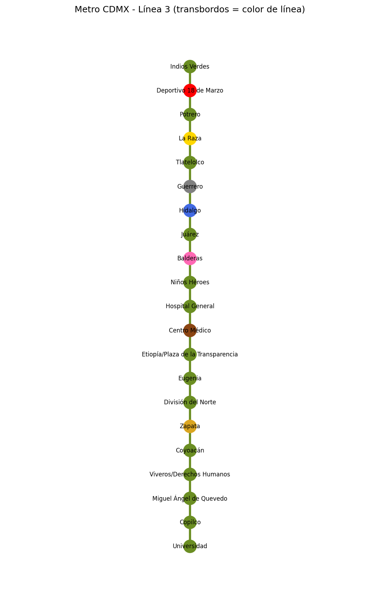

# Grafos del Metro de la Ciudad de México
## Descripción del proyecto

En este proyecto se representa la red del Sistema de Transporte Colectivo Metro de la Ciudad de México mediante la teoría de grafos. Se utiliza Python y la biblioteca NetworkX para modelar las estaciones y sus conexiones.

El proyecto contempla tanto una línea específica del Metro como la representación de la red completa.

## 2. Objetivo

Aplicar los conceptos de teoría de grafos para representar y analizar la estructura de la red del Metro de la Ciudad de México, identificando las estaciones, conexiones y correspondencias entre líneas.

## Herramientas utilizadas

- Python
- NetworkX
- Matplotlib
- Google Colab

## 3. Visualización de los grafos
### Grafo de la Línea 3
Esta representación muestra las estaciones y conexiones correspondientes a la Línea 3 del Metro.

### Red completa del Metro CDMX

En esta representación se muestra la estructura general de la red del Metro, incluyendo sus distintas líneas y conexiones.

## Repositorio del proyecto

Consulta el código fuente y los archivos del proyecto que se encuentran en un repositorio aparte.

- [Consultar el repositorio del proyecto](https://github.com/dhernandez007tech-arch/Grafos-metro-CDMX-Mat.Discretas){:target="_blank"}
- [Abrir directamente el notebook en Google Colab](https://colab.research.google.com/drive/1S5vljgVhUu6Wg2yJKitBaVvCpqvCKdmj?usp=sharing){:target="_blank"}

